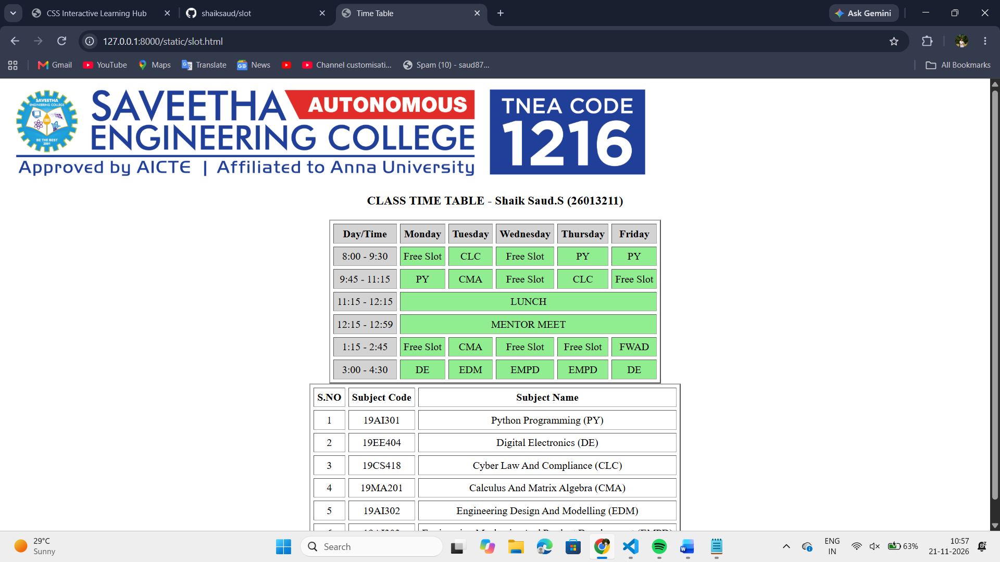

# Ex02 Time Table
## Date:21-11-2026
## AIM
To write a html webpage page to display your slot timetable.

## ALGORITHM
### STEP 1
Create a Django-admin Interface.

### STEP 2
Create an App inside the Django project.

### STEP 2
Create a static folder uder the created App and insert HTML code.

### STEP 3
Create a simple table using ```<table>``` tag in html with the relevant attributes.

### STEP 4
Add rows using ```<tr>``` tag.

### STEP 5
Add your course schedule using ```<td>``` tag.

### STEP 6
Execute the program using runserver command.

## PROGRAM
```
<html>
       <head> 
        <title>Time Table</title>
    <body> 
        
        <h3 align = "center">CLASS TIME TABLE - Shaik Saud.S (26013211)</h3>
        <table align= "center"border="2" cellspacing="5" cellpadding="5"> 
            <tr>
            <th bgcolor="lightgrey" align = "center">Day/Time</th>
            <th bgcolor="lightgrey" align = "center">Monday</th>
            <th bgcolor="lightgrey" align = "center">Tuesday</th>
            <th bgcolor="lightgrey" align = "center">Wednesday</th>
            <th bgcolor="lightgrey" align = "center">Thursday</th>
            <th bgcolor="lightgrey" align = "center">Friday</th>
            </tr>
            <tr>
            <td bgcolor="lightgrey" align = "center">8:00 - 9:30</td>
            <td bgcolor="lightgreen" align = "center">Free Slot</td>
            <td bgcolor="lightgreen" align = "center">CLC</td>
            <td bgcolor="lightgreen" align = "center">Free Slot</td>
            <td bgcolor="lightgreen" align = "center">PY</td>
            <td bgcolor="lightgreen" align = "center">PY</td>
            </tr>
            <tr>
            <td bgcolor="lightgrey" align = "center">9:45 - 11:15</td>
           <td bgcolor="lightgreen" align = "center">PY</td>
            <td bgcolor="lightgreen" align = "center">CMA</td>
            <td bgcolor="lightgreen" align = "center">Free Slot</td>
            <td bgcolor="lightgreen" align = "center">CLC</td>
            <td bgcolor="lightgreen" align = "center">Free Slot</td>
            </tr>
            <tr>
            <td bgcolor="lightgrey" align = "center">11:15 - 12:15</td>
           <td bgcolor="lightgreen" align = "center" colspan="5">LUNCH</td>
            </tr>
            <tr>
            <td bgcolor="lightgrey" align = "center">12:15 - 12:59</td>
            <td bgcolor="lightgreen" align = "center" colspan="5">MENTOR MEET</td>
            </tr>
            <tr>
            <td bgcolor="lightgrey" align = "center">1:15 - 2:45</td>
            <td bgcolor="lightgreen" align = "center">Free Slot</td>
            <td bgcolor="lightgreen" align = "center">CMA</td>
            <td bgcolor="lightgreen" align = "center">Free Slot</td>
            <td bgcolor="lightgreen" align = "center">Free Slot</td>
            <td bgcolor="lightgreen" align = "center">FWAD</td>
            </tr>
            <tr>
            <td bgcolor="lightgrey" align = "center">3:00 - 4:30</td>
            <td bgcolor="lightgreen" align = "center">DE</td>
            <td bgcolor="lightgreen" align = "center">EDM</td>
            <td bgcolor="lightgreen" align = "center">EMPD</td>
            <td bgcolor="lightgreen" align = "center">EMPD</td>
            <td bgcolor="lightgreen" align = "center">DE</td>
            </tr>
        </table>
    
        <table align="center" border="2" cellspacing="5" cellpadding="5"> 
            <tr>
            <th align = "center">S.NO</th>
            <th align = "center">Subject Code</th>
            <th align = "center">Subject Name</th>
            </tr>
            <tr>
            <td align = "center">1</td>
            <td align = "center">19AI301</td>
            <td align = "center">Python Programming (PY)</td>
            </tr>
            <tr>
            <td align = "center">2</td>
            <td align = "center">19EE404</td>
            <td align = "center">Digital Electronics (DE)</td>
            </tr>
            <tr>
            <td align = "center">3</td>
            <td align = "center">19CS418</td>
            <td align = "center">Cyber Law And Compliance (CLC)</td>
            </tr>
            <tr>
            <td align = "center">4</td>
            <td align = "center">19MA201</td>
            <td align = "center">Calculus And Matrix Algebra (CMA)</td>
            </tr>
            <tr>
            <td align = "center">5</td>
            <td align = "center">19AI302</td>
            <td align = "center">Engineering Design And Modelling (EDM)</td>
            </tr>
            <tr>
            <td align = "center">6</td>
            <td align = "center">19AI303</td>
            <td align = "center">Engineering Mechanics And Product Development (EMPD)</td>
            </tr>
        </table>
    </body>
    </head> 
</html>
```

## OUTPUT


## RESULT
The program for creating slot timetable using basic HTML tags is executed successfully.
